# Parti 1 - TP 1
## Étape 1 — Configurer Ansible
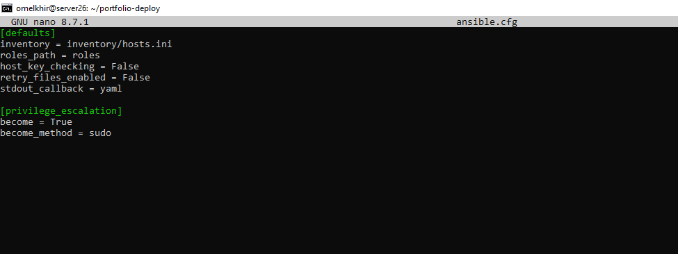
## Étape 2 — Configurer l'inventaire
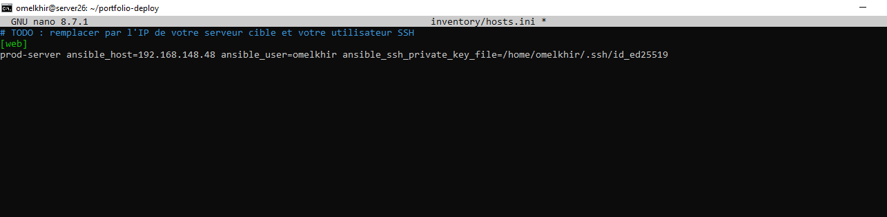
## Étape 3 — Configurer les variables
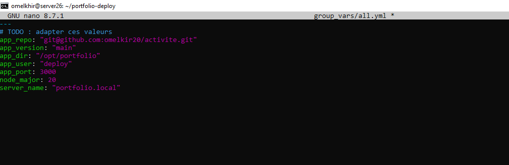
## Étape 4 — Teste Ansible
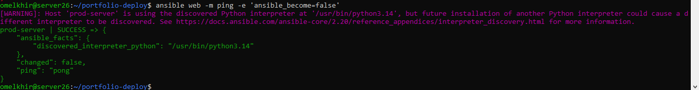
## Étape 5 — Créer les rôles Ansible
### 5.1. Rôle common : préparer le serveur
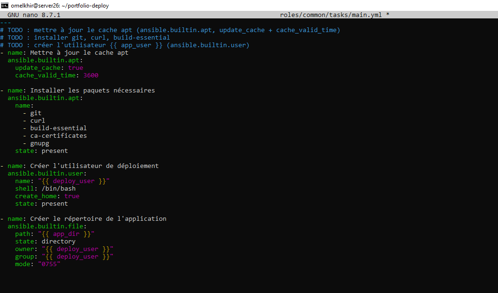
### 5.2. Rôle nodejs : installer Node.js et PM2
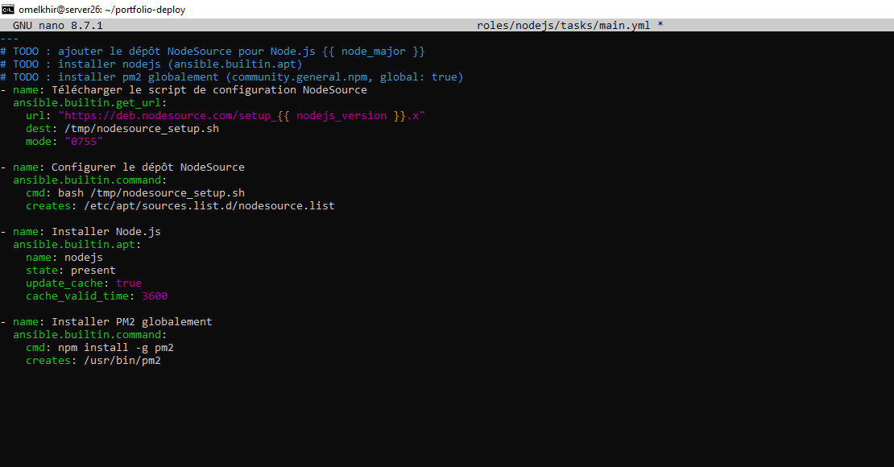
### 5.3. Rôle app : récupérer et construire Next.js
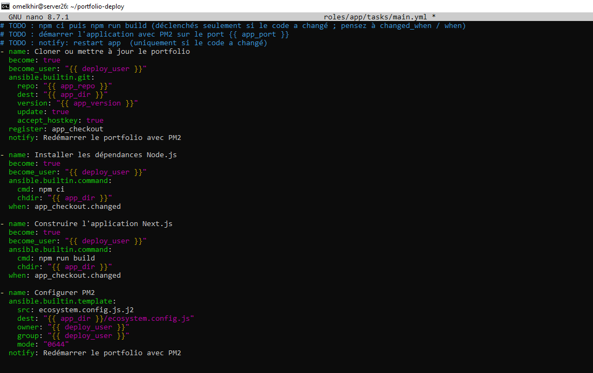
### 5.4. Créer la configuration PM2
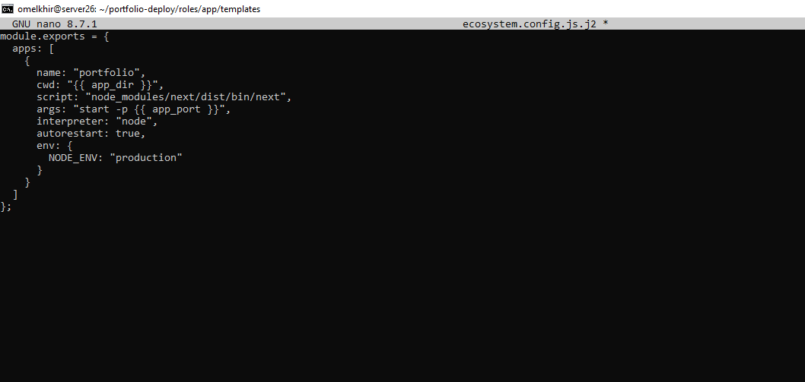
### 5.5. Créer le handler de l'application
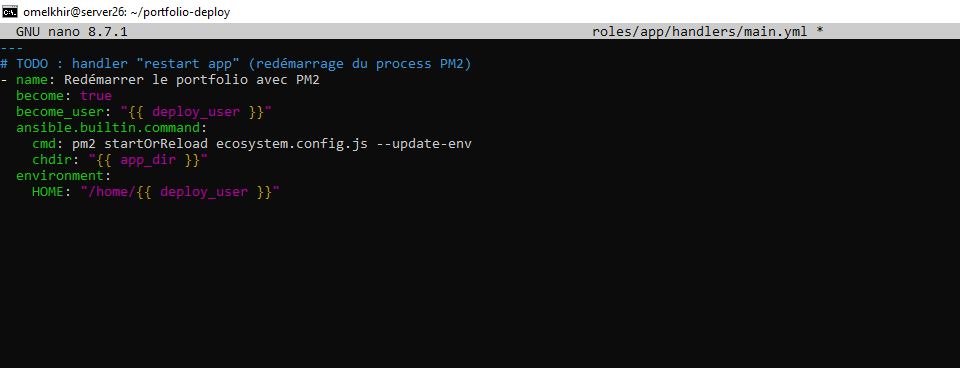
### 5.6. Rôle nginx : configurer le reverse proxy
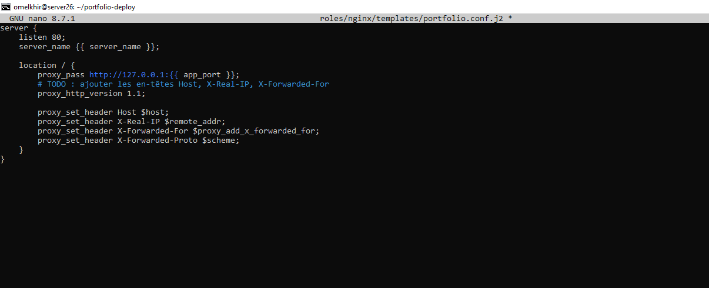
### 5.7. Créer les tâches Nginx
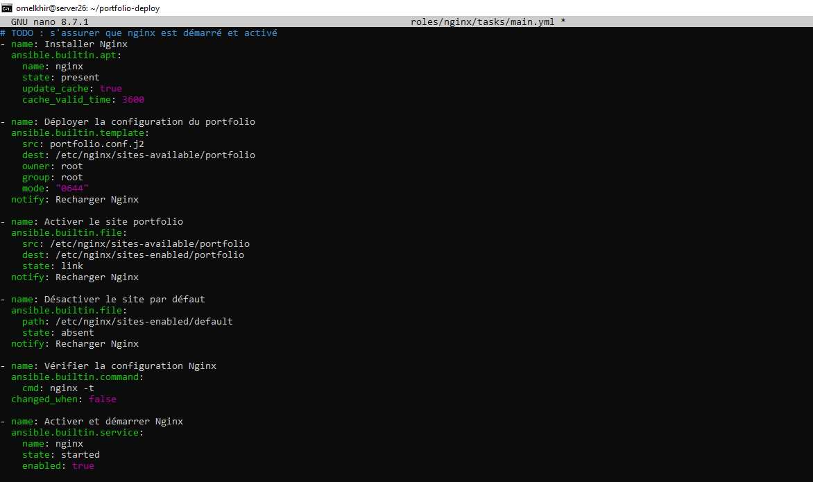
### 5.8. Créer le handler Nginx
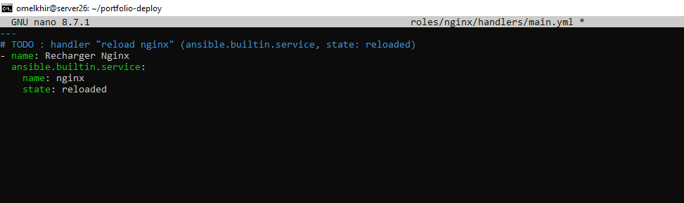
### 5.9. Créer le playbook principal
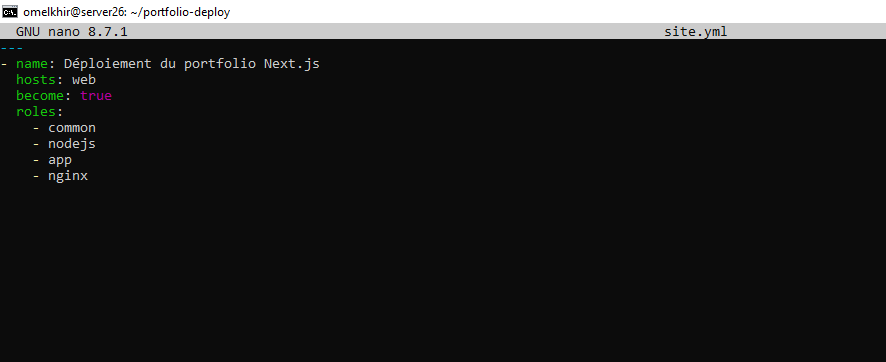
## Étape 6 — Vérifier et exécuter Ansible
### 6.1. Vérifier la syntaxe YAML _ Simuler le déploiement
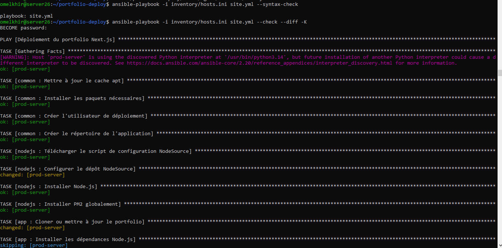
### 6.2. Lancer le déploiement réel
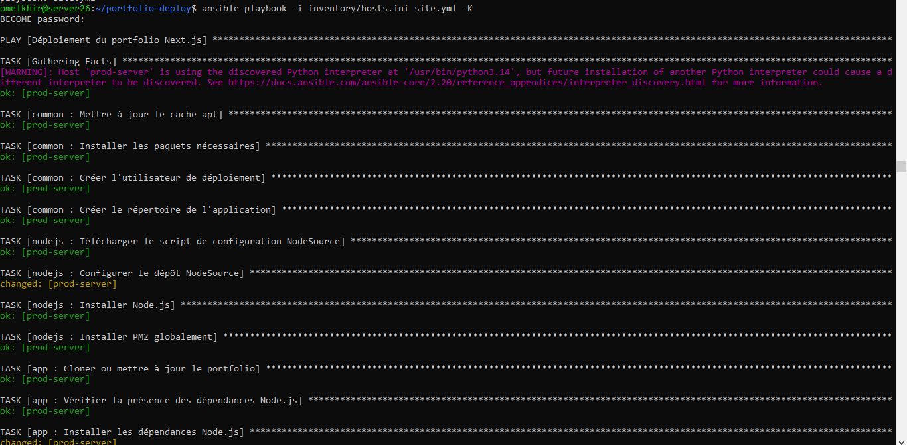
### 6.3. Vérifier que l'application fonctionne
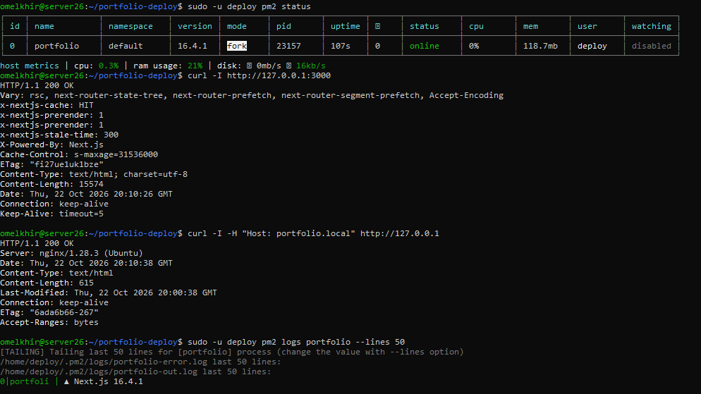
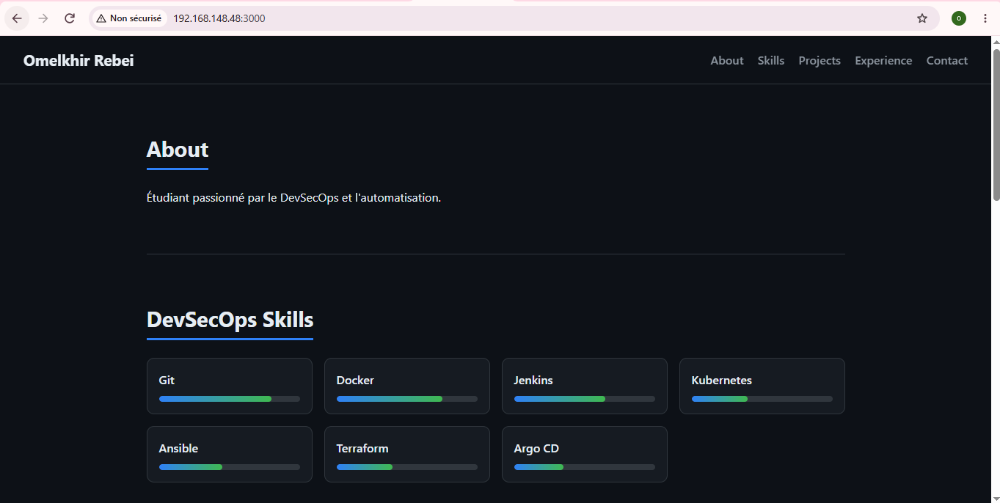
## Étape 7 — Installer et configurer Semaphore UI
### 7.1. Installer
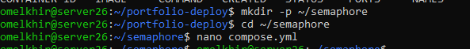
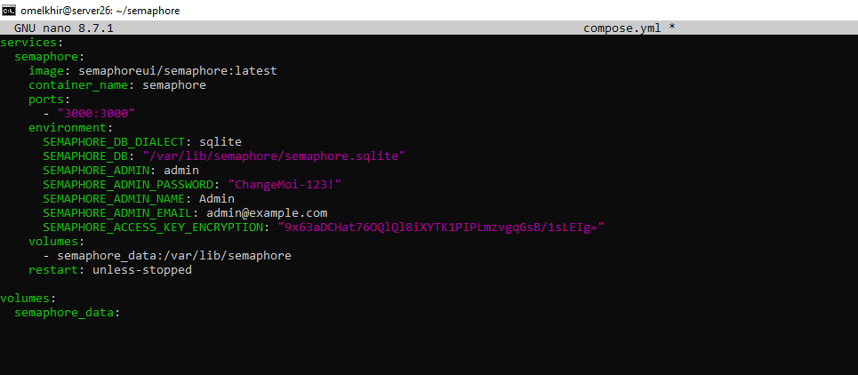
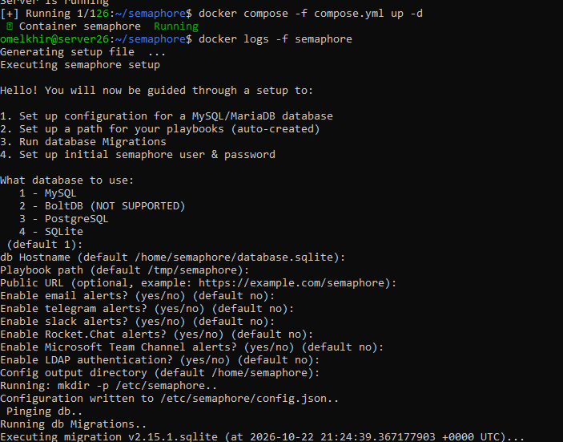
### 7.2. Créer le projet
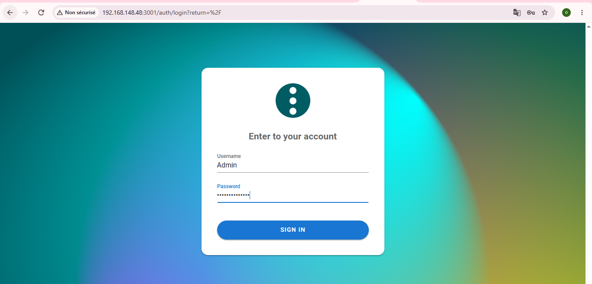
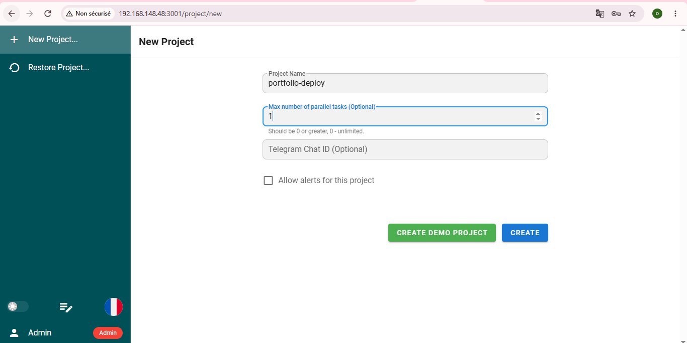

